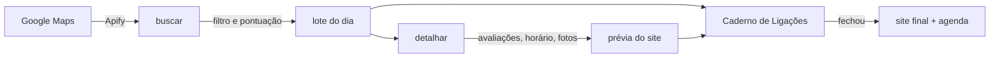

# Cold call de sites

Ferramentas para vender sites a pequenos negócios locais por telefone. O projeto encontra barbearias e estéticas que ainda não têm site, organiza as ligações num caderno que funciona no celular e gera, para cada negócio, uma prévia do próprio site com agenda online. Quem liga já chega com o site pronto para mostrar.

Começa pela Grande Florianópolis (Florianópolis, São José, Palhoça e Biguaçu) e foi pensado para crescer para outras cidades.

> **Status:** a primeira parte ([Plano A](docs/superpowers/plans/2026-10-09-plano-a-prospeccao-painel.md): busca de leads e caderno de ligações) está pronta e em uso. A segunda (prévias, sites e agenda) ainda vai ser planejada. Design completo na [spec](docs/superpowers/specs/2026-10-09-cold-call-sites-design.md).

## Para que serve

| Etapa | O que o projeto faz |
|---|---|
| Achar clientes | Busca negócios no Google Maps, descarta quem já tem site próprio e prioriza quem tem muitas avaliações, nota alta e celular. Quem só tem Instagram ou link de bio entra como lead quente. |
| Ligar | Um caderno de ligações protegido por senha, pensado para o celular: botão de ligar, telefone para copiar, botões de WhatsApp, Instagram e Maps, status, próximo contato, notas e roteiro de ligação. |
| Mostrar | Cada lead ganha uma prévia do próprio site, com nome, fotos, avaliações reais e agenda online de demonstração. |
| Entregar | Quando o negócio fecha, a prévia vira o site final no domínio `.com.br` do cliente, com a agenda ligada ao Google Agenda dele. |

## Como funciona



## O Plano A, passo a passo

O Plano A cobre tudo até a ligação: achar os negócios, escolher os melhores e entregar a lista num caderno que abre no celular. Cada passo é um comando; os dados ficam na pasta `leads/`, que não vai para o git.

### 1. Buscar candidatos

```bash
npm run buscar -- --nicho barbearia --cidade "São José"
```

- Chama o scraper de Google Maps da [Apify](https://apify.com/compass/crawler-google-places) com os termos do nicho (em `prospeccao/config.json`) na cidade escolhida, no modo mais barato: sem página de detalhe, fotos ou avaliações.
- Descarta quem está fechado, quem não tem telefone, quem fica fora das quatro cidades e quem já tem site próprio.
- Classifica o campo "site" do Google: sem site, ou só rede social, link de bio ou app de agenda (Instagram, Linktree, WhatsApp, Booksy, Trinks, AppBarber, Calendly e outros). Os dois tipos viram lead; do Instagram sai o @.
- Dá uma pontuação de 0 a 100: avaliações (até 50), nota (até 25), celular (15) e Instagram identificado (10).
- Grava um arquivo por lead em `leads/` e guarda o ID de cada lugar que virou lead, para ele não voltar numa busca futura. Lugares descartados são reavaliados de graça na busca seguinte.
- Antes de rodar, confere o saldo da Apify e recusa a busca se ela puder passar do teto de gasto (US$1 por execução). Uma busca de 40 lugares custa cerca de US$0,16.

### 2. Montar o lote do dia

```bash
npm run lote -- --quantidade 25
```

Separa os 25 candidatos de maior pontuação. Dá para filtrar com `--nicho` e `--cidade`.

### 3. Detalhar o lote

```bash
npm run detalhar
```

Faz uma segunda busca só com os leads do lote, agora com página de detalhe: horário de funcionamento, coordenadas, até 5 avaliações e até 4 fotos, salvas em `sites/public/fotos/`. Esse material alimenta as prévias do Plano B. Custa cerca de US$0,26 para 25 leads.

### 4. Publicar o caderno

```bash
npm run painel:construir   # gera painel/dist/index.html com os leads criptografados
npm run painel:publicar    # envia para o GitHub Pages
npm run painel:local       # ou abre no computador, em http://localhost:4173
```

O caderno é uma página estática. Os leads vão criptografados dentro dela com a senha de `senha.env`: AES-256-GCM com chave derivada por PBKDF2-SHA256 (600 mil iterações). Sem a senha, o endereço não mostra nada. A página não é indexada por buscadores e não manda o próprio endereço para os sites abertos a partir dela.

### 5. Ligar

- A lista segue a próxima ação: primeiro os retornos do dia, depois os leads novos por pontuação. Filtros por situação, nicho e cidade.
- Cada cartão traz nome, bairro, nota e número de avaliações, além dos botões de ligar, WhatsApp, Instagram e Maps, e o telefone para copiar.
- Status: novo, sem resposta, retornar, interessado, reunião, fechou e perdeu. Interessado, reunião e fechou pedem o plano e o preço oferecidos; perdeu pede o motivo.
- Um indicador acompanha quantos dos últimos 10 interessados recusaram por preço e sugere subir ou baixar a tabela em R$10.
- A aba Roteiro traz abertura, perguntas, proposta, fechamento, respostas para as objeções mais comuns e a tabela de preços.

Status, notas e datas ficam salvos no navegador de quem liga, por cima da lista publicada. Publicar um lote novo não apaga nada do que já foi anotado.

### 6. Backup e limpeza

- Em Roteiro, **Exportar backup** baixa e copia um arquivo com todas as anotações. **Importar** restaura o backup ou leva as anotações para outro aparelho. Faça um backup por semana: se o navegador apagar os dados do site, eles só voltam pelo backup.
- A cada duas semanas, salve um backup recente (de menos de 1 hora) em `leads/_sistema/painel-status.json` e rode `npm run limpar`. Ele apaga os dados e as fotos de leads perdidos, e de leads novos ou sem resposta parados há mais de 14 dias. Depois, gere e publique o caderno de novo. As suas anotações continuam visíveis no caderno, como arquivadas.

## O Plano B (a planejar): prévias, sites e agenda

- Site de uma página feito com Astro, a partir de um template por nicho e de uma ficha por negócio (cores, textos, serviços, fotos e depoimentos).
- Prévias publicadas no Cloudflare Pages, fora dos buscadores e com aviso de prévia.
- Agenda sem banco de dados: uma agenda do Google Agenda por profissional e um Google Apps Script que calcula os horários livres e cria os agendamentos.

## Estrutura

| Pasta | Conteúdo |
|---|---|
| `prospeccao/` | busca, filtro, pontuação, lote, detalhes e limpeza (Plano A) |
| `painel/` | Caderno de Ligações: página, regras, criptografia e build (Plano A) |
| `sites/` | projeto Astro das prévias e dos sites (Plano B) |
| `agenda/` | Apps Script da agenda (Plano B) |
| `docs/superpowers/` | spec e planos de implementação |
| `.claude/skills/` | skills de design usadas pelo Claude Code |

## Como usar

Requisitos: Node.js 24 ou mais novo e uma conta grátis na Apify. O plano grátis dá US$5 de crédito por mês e não pede cartão.

```bash
git clone https://github.com/NeekNegoer/cold-call-sites.git
cd cold-call-sites
npm install
cp .env.example .env   # depois cole o seu APIFY_TOKEN no .env
```

Para o caderno, crie também um `senha.env` com `PAINEL_SENHA=` e uma frase longa (16 caracteres ou mais). Ele é ignorado pelo git. Para publicar no GitHub Pages, `painel/dist/` precisa ser um clone de um repositório seu com o Pages ligado na branch `main`.

Comandos:

| Comando | O que faz |
|---|---|
| `npm run buscar -- --nicho barbearia --cidade "São José"` | busca e pontua novos candidatos |
| `npm run lote -- --quantidade 25` | separa o lote do dia para o caderno |
| `npm run detalhar` | busca avaliações, horário e fotos do lote |
| `npm run limpar` | apaga dados de leads perdidos ou parados há 14 dias (lê o backup exportado no caderno) |
| `npm run painel:construir` | gera o caderno criptografado em `painel/dist/index.html` |
| `npm run painel:local` | abre o caderno em http://localhost:4173 |
| `npm run painel:publicar` | envia o caderno gerado para o repositório do GitHub Pages em `painel/dist` |
| `npm test` | roda os testes |

## Privacidade

- Nada pessoal vai para o repositório. O token fica em `.env`, a senha do caderno em `senha.env`, os dados coletados em `leads/`, as fotos em `sites/public/fotos/` e os backups do caderno em `caderno-backup-*.json`, todos ignorados pelo git.
- Os dados coletados são um cache de trabalho curto: leads perdidos ou parados há mais de 14 dias são apagados, e ficam só o ID do lugar e as anotações de quem ligou.
- O Caderno de Ligações só abre com a senha: o arquivo publicado leva os leads criptografados, não é indexado por buscadores e não manda o endereço para os sites abertos a partir dele.
- A Apify coleta páginas públicas do Google Maps. A seção de riscos da spec explica essa escolha e a alternativa oficial.

## Custos

| Item | Custo |
|---|---|
| Apify | grátis até US$5 por mês; um lote completo (busca de uns 80 lugares e detalhes de 25) custa cerca de US$0,60 |
| GitHub Pages (caderno) | grátis |
| Cloudflare Pages | grátis |
| Domínio `.com.br` | R$40 por ano por cliente, coberto pela manutenção mensal |

## Como foi feito

Planejado e construído com o [Claude Code](https://claude.com/claude-code), seguindo o fluxo do [superpowers](https://github.com/obra/superpowers): brainstorming, spec e plano de implementação com tarefas pequenas e testes antes do código.

## Créditos

- Skills de design de [Emil Kowalski](https://github.com/emilkowalski/skills), sob licença MIT (cópia em `.claude/skills/LICENSE-emilkowalski-skills`).
- Scraper de Google Maps: [Apify](https://apify.com/compass/crawler-google-places).

## Licença

Código e documentação sob a [PolyForm Noncommercial 1.0.0](LICENSE.md): você pode ver, estudar e usar para fins não comerciais. Uso comercial, como vender sites com estas ferramentas, só com autorização; abra uma issue para conversar. As skills em `.claude/skills/` são de Emil Kowalski e seguem a licença MIT dele.
