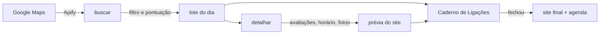

# Cold call de sites

Ferramentas para vender sites a pequenos negócios locais por telefone. O projeto encontra barbearias e estéticas que ainda não têm site, organiza as ligações num caderno que funciona no celular e gera, para cada negócio, uma prévia do próprio site com agenda online. Quem liga já chega com o site pronto para mostrar.

Começa pela Grande Florianópolis (Florianópolis, São José, Palhoça e Biguaçu) e foi pensado para crescer para outras cidades.

> **Status:** em construção. O design ([spec](docs/superpowers/specs/2026-10-09-cold-call-sites-design.md)) e o plano de implementação da primeira parte ([Plano A](docs/superpowers/plans/2026-10-09-plano-a-prospeccao-painel.md)) estão prontos. O código vem a seguir.

## Para que serve

| Etapa | O que o projeto faz |
|---|---|
| Achar clientes | Busca negócios no Google Maps, descarta quem já tem site próprio e prioriza quem tem muitas avaliações, nota alta e celular. Quem só tem Instagram ou link de bio entra como lead quente. |
| Ligar | Um caderno de ligações privado no claude.ai, pensado para o celular: telefone para copiar, botões de WhatsApp, Instagram e Maps, status, próximo contato, notas e roteiro de ligação. |
| Mostrar | Cada lead ganha uma prévia do próprio site, com nome, fotos, avaliações reais e agenda online de demonstração. |
| Entregar | Quando o negócio fecha, a prévia vira o site final no domínio `.com.br` do cliente, com a agenda ligada ao Google Agenda dele. |

## Como funciona



### 1. Prospecção (Plano A)

- `buscar` chama o scraper de Google Maps da [Apify](https://apify.com/compass/crawler-google-places) por nicho e cidade, no modo mais barato (sem fotos e sem avaliações).
- Cada lugar é classificado pelo campo "site" do Google: sem site; só rede social, link de bio ou app de agenda; ou site próprio (fora desta versão).
- A pontuação vai de 0 a 100: avaliações (até 50), nota (até 25), celular (15) e Instagram identificado (10).
- `lote` separa os 25 melhores do dia e prepara os documentos do caderno.
- `detalhar` busca avaliações, horário e fotos só desses 25, para montar as prévias.
- Toda execução confere o saldo da Apify antes de rodar, respeita um teto de gasto e registra o custo.

### 2. Caderno de Ligações (Plano A)

Uma página privada publicada como artifact no claude.ai, com banco de dados próprio. O Claude grava os leads e quem liga atualiza tudo pelo celular.

- A lista segue a próxima ação: primeiro os retornos do dia, depois os leads novos por pontuação.
- Status: novo, sem resposta, retornar, interessado, reunião, fechou e perdeu. Marcar como perdido exige o motivo.
- O plano e o preço oferecidos ficam registrados. Um indicador acompanha quantos dos últimos 10 interessados recusaram por preço e sugere subir ou baixar a tabela.
- A aba Roteiro traz abertura, perguntas, proposta, fechamento e respostas para as objeções mais comuns.

### 3. Prévias, sites e agenda (Plano B)

- Site de uma página feito com Astro, a partir de um template por nicho e de uma ficha por negócio (cores, textos, serviços, fotos e depoimentos).
- Prévias publicadas no Cloudflare Pages, fora dos buscadores e com aviso de prévia.
- Agenda sem banco de dados: uma agenda do Google Agenda por profissional e um Google Apps Script que calcula os horários livres e cria os agendamentos.

## Estrutura

| Pasta | Conteúdo |
|---|---|
| `prospeccao/` | busca, filtro, pontuação, lote, detalhes e limpeza (Plano A) |
| `painel/` | página do Caderno de Ligações e as regras dela (Plano A) |
| `sites/` | projeto Astro das prévias e dos sites (Plano B) |
| `agenda/` | Apps Script da agenda (Plano B) |
| `docs/superpowers/` | spec e planos de implementação |
| `.claude/skills/` | skills de design usadas pelo Claude Code |

## Como usar

Requisitos: Node.js 24 ou mais novo e uma conta grátis na Apify. O plano grátis dá US$5 de crédito por mês e não pede cartão.

```bash
git clone https://github.com/NeekNegoer/cold-call-sites.git
cd cold-call-sites
npm install
cp .env.example .env   # depois cole o seu APIFY_TOKEN no .env
```

Comandos, disponíveis quando o Plano A estiver implementado:

| Comando | O que faz |
|---|---|
| `npm run buscar -- --nicho barbearia --cidade "São José"` | busca e pontua novos candidatos |
| `npm run lote -- --quantidade 25` | separa o lote do dia para o caderno |
| `npm run detalhar` | busca avaliações, horário e fotos do lote |
| `npm run limpar` | apaga dados de leads perdidos ou parados há 14 dias |
| `npm test` | roda os testes |

## Privacidade

- Nada pessoal vai para o repositório. O token fica em `.env`, os dados coletados em `leads/` e as fotos em `sites/public/fotos/`, todos ignorados pelo git.
- Os dados coletados são um cache de trabalho curto: leads perdidos ou parados há mais de 14 dias são apagados, e ficam só o ID do lugar e as anotações de quem ligou.
- O Caderno de Ligações é privado no claude.ai.
- A Apify coleta páginas públicas do Google Maps. A seção de riscos da spec explica essa escolha e a alternativa oficial.

## Custos

| Item | Custo |
|---|---|
| Apify | grátis até US$5 por mês, o que rende vários lotes |
| Cloudflare Pages | grátis |
| Domínio `.com.br` | R$40 por ano por cliente, repassado na mensalidade |

## Como foi feito

Planejado e construído com o [Claude Code](https://claude.com/claude-code), seguindo o fluxo do [superpowers](https://github.com/obra/superpowers): brainstorming, spec e plano de implementação com tarefas pequenas e testes antes do código.

## Créditos

- Skills de design de [Emil Kowalski](https://github.com/emilkowalski/skills), sob licença MIT (cópia em `.claude/skills/LICENSE-emilkowalski-skills`).
- Scraper de Google Maps: [Apify](https://apify.com/compass/crawler-google-places).
